# System Design Overview & Operations Flow (Contracts)

---

## 1. Cloud vs. Local Split

### 1.1. Core Principles

```text
AWS = Durable Control Plane          | Local = Rebuildable AI/Data Plane
-------------------------------------|---------------------------------------
Auth, API, durable storage           | Parse, chunk, embed, retrieve, LLM
State, jobs, messages, flashcards    | Vector index, model cache
Queue, DLQ, log, metric, alarm       | Temporary files, local log
```

**Crucial Point:** AWS **never** opens inbound connections to the local machine. The local worker **actively** polls and calls the cloud.

### 1.2. Detailed Component Split

| Component | Cloud (AWS) | Local |
|---|---|---|
| **Frontend Assets** | S3 + CloudFront + OAC | — |
| **Identity** | Cognito User Pool + App Client | — |
| **API** | API Gateway HTTP API + JWT Authorizer | — |
| **Lambda Functions** | 6 functions | — |
| **Original Documents** | S3 Bucket (Private) | — |
| **DynamoDB** | 7 tables + GSIs | — |
| **Queue** | 2 SQS + 2 DLQs | — |
| **Worker** | — | Python process |
| **Parser** | — | TXT, MD, PDF |
| **Chunker** | — | StructureAwareChunker |
| **Embedding** | — | mpnet-base-v2 (768d) |
| **Vector Store** | — | SQLite (`m3_index.db`) |
| **BM25 Index** | — | `rank_bm25` (in-memory) |
| **Retriever** | — | Hybrid (Dense + Sparse) |
| **Reranker** | — | BGE Cross-Encoder |
| **LLM** | — | Groq / OpenAI / Gemini |
| **Guardrails** | — | Input/Output regex + NLI |
| **Model Cache** | — | Local disk |

### 1.3. Data Placement

| Data | Location | Authoritative Source |
|---|---|---|
| Frontend assets | Frontend S3 | Source repository |
| Identity | Cognito | Cognito |
| Original documents | Document S3 | S3 |
| Documents/Sessions/Jobs | DynamoDB | DynamoDB table |
| Chat answers + citations | `StudyBotMessages` | Messages table |
| Flashcards | `StudyBotFlashcards` | Flashcards table |
| Job notification | SQS | *Not authoritative* |
| Parsed chunks + embeddings | Local Vector Store | Rebuildable derived index |
| Model files | Local model cache | Model source/release |

**Principle:** If the local index is lost → download original documents from S3 → re-ingest.

---

## 2. Workflow 1 — Document Upload

### 2.1. Flow Diagram

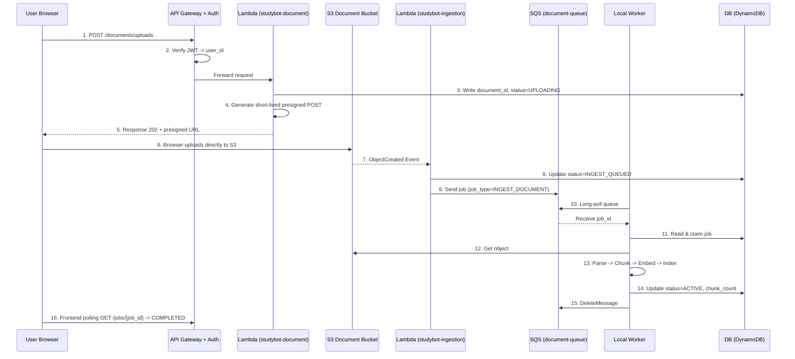

### 2.2. Document Status Lifecycle

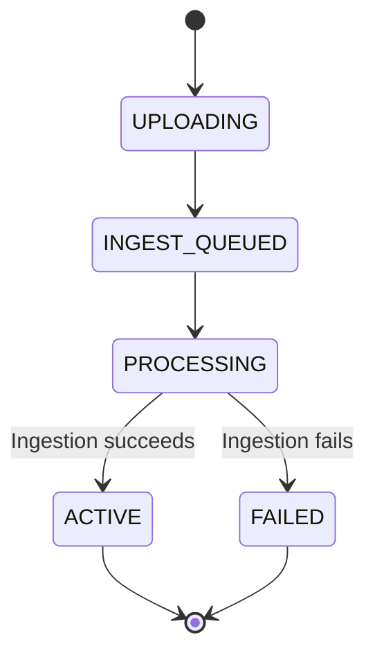

### 2.3. Storage Locations

| Data | Storage Location |
|---|---|
| Original File | S3 Document Bucket |
| Document Metadata | `StudyBotDocuments` (DynamoDB) |
| Job State | `StudyBotJobs` (DynamoDB) |
| Job Notification | `studybot-document-queue` (SQS) |
| Job Payload | DynamoDB (SQS only has `job_id` + `job_type`) |
| Parsed Blocks | Local `bundle_all/blocks.jsonl` |
| Chunks | Local `chunks.jsonl` |
| Embeddings | Local SQLite (`m3_index.db`) |
| BM25 Index | Local in-memory |

### 2.4. Upload Security Mechanisms

| Mechanism | Purpose |
|---|---|
| Presigned POST | Short-lived URL, restricts key/content-type/size. |
| Extension + MIME Check | Preliminary check at API level. |
| Magic bytes + parser validation | Actual verification during ingestion by the worker. |
| Private Bucket + Block Public Access | Ensures nobody can read objects directly. |
| CloudFront OAC | Only allows the frontend bucket to be read via CF. |

---

## 3. Workflow 2 — Query

### 3.1. Flow Diagram

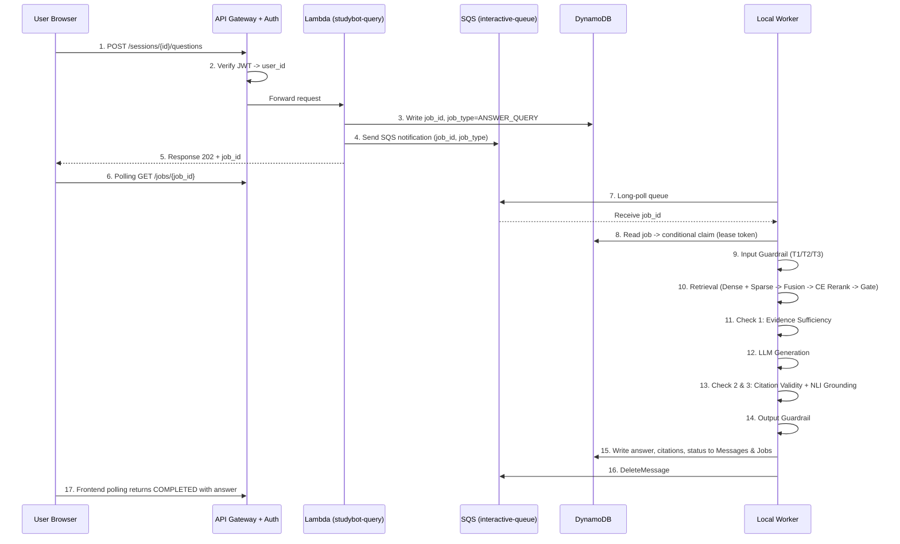

### 3.2. Output Status Definitions

| Status | Meaning |
|---|---|
| `acceptance` | Answered successfully; evidence is strong enough. |
| `ambiguous` | Low confidence; high risk of hallucination. |
| `rejection` | System error (guardrail triggered, invalid citations, false refusal). |
| `refusal` | Context insufficient to answer (truthful refusal). |

### 3.3. Storage Locations

| Data | Storage Location |
|---|---|
| User Query | `StudyBotMessages` (DynamoDB) |
| Answer + Citations | `StudyBotMessages` (Authoritative) |
| Job State | `StudyBotJobs` (DynamoDB) |
| Polling Result Copy | `StudyBotJobs.result` |
| Job Notification | SQS (*Not authoritative*) |
| RAG Telemetry | Local worker log |
| Audit Trail | Local JSONL (`_data/logs/YYYY-MM-DD.jsonl`) |

### 3.4. Job Structure in DynamoDB

| Field | Purpose |
|---|---|
| `job_id` | Partition Key |
| `job_type` | Job category (`ANSWER_QUERY`, `INGEST_DOCUMENT`, etc.) |
| `job_version` | Contract version |
| `worker_id` | Identifier of worker holding the claim |
| `lease_token` | Fencing token |
| `lease_expires_at` | Lease expiration timestamp |
| `attempt_count` | Number of execution attempts |
| `max_attempts` | Maximum allowed attempts |
| `last_error` | Most recent error message |
| `next_attempt_at` | Backoff timestamp for next attempt |
| `result` | Small denormalized copy for client polling |

---

## 4. Workflow 3 — Generate Flashcards

### 4.1. Flow Diagram

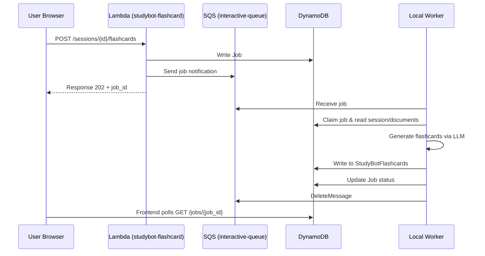

**Storage Details:**
- Flashcards are stored in `StudyBotFlashcards` (DynamoDB).
- GSI: `DocumentFlashcards(document_id, flashcard_id)`.

---

## 5. Workflow 4 — Delete Document

### 5.1. Flow Diagram

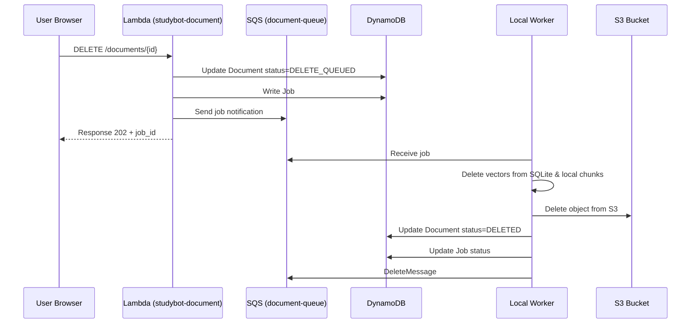

**Critical Rule:** `DELETE_QUEUED` **immediately** excludes the document from retrieval, even while physical cleanup is pending.

### 5.2. Delete Status Lifecycle

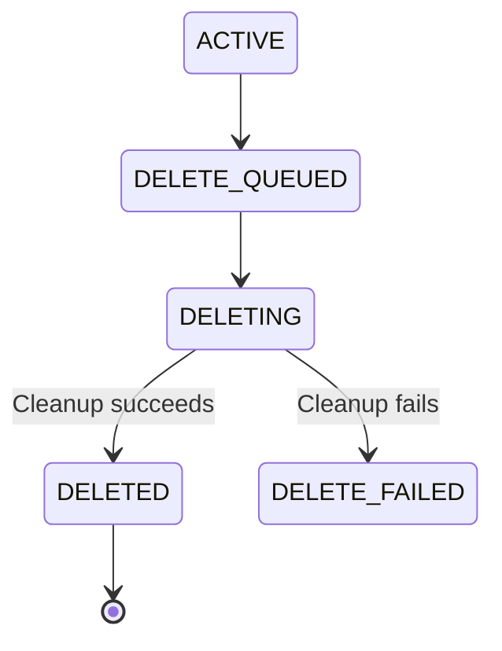

---

## 6. Workflow 5 — Session Management

- `POST /sessions` → Create a new session.
- `GET /sessions` → List all sessions for a user.
- `GET /sessions/{id}` → Get session details.
- `POST /sessions/{id}/documents/{doc_id}` → Attach a document to a session.
- `DELETE /sessions/{id}/documents/{doc_id}` → Detach a document from a session.

**Storage Details:**
- Sessions are stored in `StudyBotSessions`.
- Session-Document mappings are in `StudyBotSessionDocuments`.
- GSI `UserSessions(user_id, updated_at)`.
- GSI `DocumentSessions(document_id, session_id)`.

---

## 7. Workflow 6 — Message History

- `GET /sessions/{id}/messages`

**Storage Details:**
- Messages are stored in `StudyBotMessages`.
- Key format: `(session_id, created_at#message_id)`.
- The assistant message identity is derived from the `job_id`.

---

## 8. Internal Local Worker Flow

### 8.1. SQS + DynamoDB Synchronization Pattern

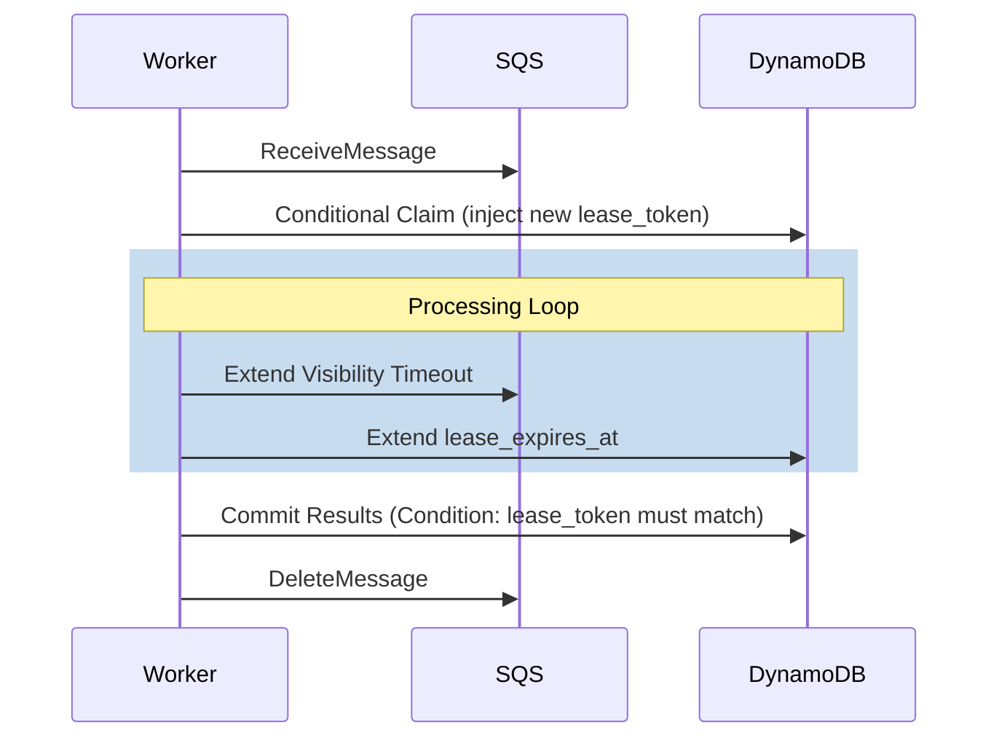

**Lease Token = Fencing Token:** An old worker cannot overwrite a job that has been reclaimed by another worker after a timeout.

### 8.2. Failure Handling Strategy

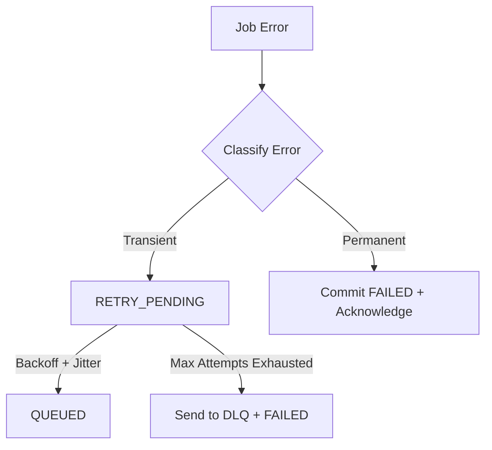

| Error Type | Examples |
|---|---|
| **Transient** | Network timeouts, AWS throttling, temporary model/vector-store failures. |
| **Permanent** | Document corruption, invalid payloads, resource unauthorized. |

### 8.3. Idempotency Rules

- Ingestion upserts are stable based on `document_id + index_version`.
- Assistant message IDs are deterministically derived from `job_id`.
- Flashcard batches are tied to `job_id`.
- Deleting vectors or S3 objects that no longer exist is treated as a success.
- If a message is redelivered after reaching a terminal state, the worker simply acknowledges (deletes) it without re-executing side effects.

---

## 9. RAG Pipeline Flow (M1–M6)

### 9.1. Ingestion Pipeline

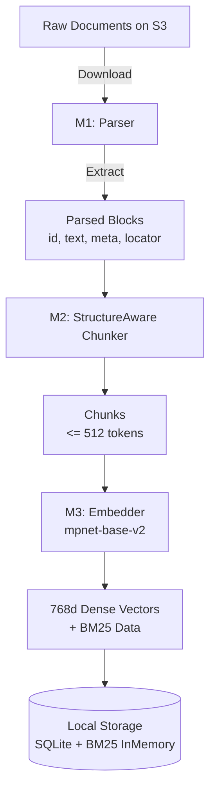

### 9.2. Query Pipeline

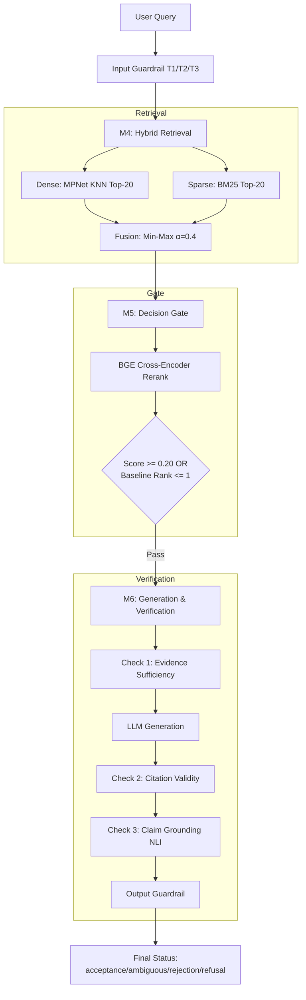

---

## 10. System Interaction Flows (Summary)

### 10.1. User → System

| # | Trigger | Lambda | Queue | Local Worker Role |
|---|---|---|---|---|
| 1 | Upload document | `studybot-document` | Document | Ingest |
| 2 | List documents | `studybot-document` | — | — |
| 3 | Delete document | `studybot-document` | Document | Delete |
| 4 | Create session | `studybot-session` | — | — |
| 5 | Attach/detach doc | `studybot-session` | — | — |
| 6 | Ask question | `studybot-query` | Interactive | Answer |
| 7 | View message history| `studybot-query` | — | — |
| 8 | Generate flashcards | `studybot-flashcard`| Interactive | Generate |
| 9 | View flashcards | `studybot-flashcard`| — | — |
| 10| Poll job status | `studybot-job` | — | — |

### 10.2. System → System (AWS Internal)

| # | Trigger | Source | Target |
|---|---|---|---|
| 11| S3 ObjectCreated | S3 | Lambda `studybot-ingestion-event` |
| 12| Ingestion event | Lambda | DynamoDB + SQS Document Queue |
| 13| Job created | Lambda | SQS Notification |
| 14| JWT Auth | Cognito | API Gateway Authorizer |
| 15| Invocation | API Gateway| Respective Lambda |

### 10.3. Cloud ↔ Local

| # | Direction | Mechanism |
|---|---|---|
| 16| Local → SQS | Long-poll outbound via TLS |
| 17| Local → DynamoDB | `GetItem` / Conditional `UpdateItem` |
| 18| Local → S3 | `GetObject` / `DeleteObject` |
| 19| Local → DynamoDB | Heartbeat updates (`last_seen_at`) |
| 20| Local → SQS | Extend visibility timeout, `DeleteMessage` |

### 10.4. Internal Local Worker Execution

| # | Step | Input | Output |
|---|---|---|---|
| 21| Parse | Raw file | `blocks.jsonl` |
| 22| Chunk | Blocks | `chunks.jsonl` |
| 23| Embed | Chunks | Vectors |
| 24| Index | Vectors + Chunks | SQLite + BM25 |
| 25| Retrieve| Query | Top-K chunks |
| 26| Rerank | Top-K chunks | Reranked chunks |
| 27| Generate| Evidence | Answer + citations |
| 28| Verify | Answer | Final status |

---

## 11. Observability Flow

### 11.1. Signals Monitored

| Area | Key Signals |
|---|---|
| **Lambda** | Invocations, errors, duration, throttles. |
| **SQS** | Visible/in-flight messages, oldest-message age, DLQ depth. |
| **Jobs** | Count of created, completed, failed, retried jobs by type. |
| **Worker** | Heartbeat age, active jobs count, lease-extension failures. |
| **RAG Runtime**| Latency (parsing/embedding/retrieval/generation), retrieved chunks, refusal rates, citation maps. |

### 11.2. Correlation IDs

- `job_id`: The primary correlation ID bridging the API, Queue, and Worker.
- `request_id`: Correlates the originating API Gateway call.

### 11.3. Alert Triggers

| Alert | Condition |
|---|---|
| DLQ not empty | Any message lands in the DLQ. |
| Queue age high | Message age exceeds defined SLO. |
| Lambda Error/Throttle | Error or throttle rates spike. |
| Worker Stale | Heartbeat is stale AND queue has pending work. |
| Lease Failures | High rate of lease-extension failures. |

---

## 12. CI/CD + Deployment Flow

### 12.1. Terraform Bootstrap

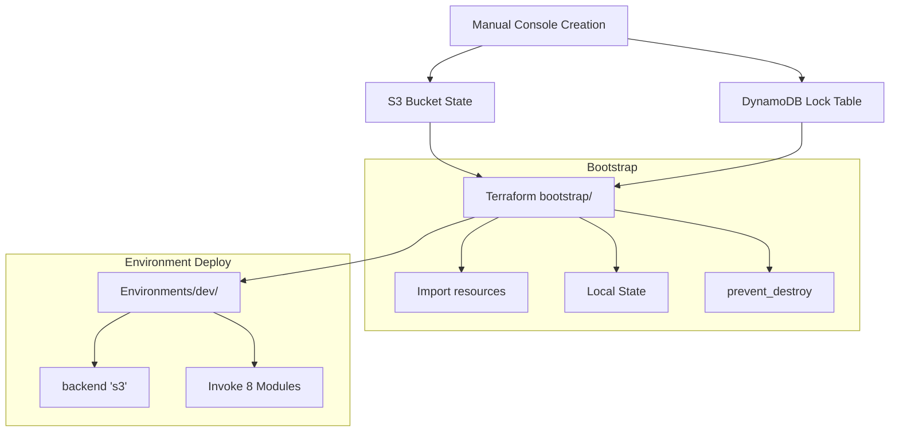

### 12.2. Terraform Module Structure

```text
infrastructure/
├── bootstrap/          ✅ (Completed)
├── modules/
│   ├── storage/        <- (In Progress)
│   ├── auth/
│   ├── database/
│   ├── messaging/
│   ├── compute/
│   ├── api/
│   ├── observability/
│   └── frontend/
└── environments/dev/
```

---

## 13. Core Guiding Principles

| # | Principle | Source Ref |
|---|---|---|
| 1 | AWS never opens inbound connections to local. | ADR-001 |
| 2 | SQS is strictly for notifications; DynamoDB is the source of truth. | 01, 02 |
| 3 | System assumes at-least-once delivery; never exactly-once. | 04 |
| 4 | Lease tokens act as strict fencing tokens. | 04 |
| 5 | Conditional writes are mandatory for all claim/terminal updates. | 02, 04 |
| 6 | Local index must be entirely rebuildable from S3. | 01, 03 |
| 7 | Implement least-privilege IAM (1 specific role per Lambda). | 03 |
| 8 | `user_id` is strictly derived from JWT, never from request body. | 03 |
| 9 | Logs exclude tokens, credentials, presigned URLs, and payload content. | 03 |
| 10| Avoid high-cardinality IDs as metric dimensions. | 04 |
| 11| Fixed alpha fusion rejected; use Decision Gate instead. | ADR-005, ADR-006 |
| 12| Conservative aggregation: if any check is AMBIGUOUS -> overall is AMBIGUOUS. | 14 |
| 13| Evidence must be per-claim; no shared evidence across claims. | 14 |
| 14| Terraform state must be remote and locked. | ADR-002 |

---

## 14. Notable Implementation Points

1. If the local worker goes offline, AI tasks halt, but jobs survive in SQS (retention period).
2. The system uses Frontend polling for status, not SSE/streaming (deferred execution).
3. **Check 1** (Evidence Sufficiency) is currently **BYPASSED** in the code (`handlers.py`).
4. The refusal threshold is currently in `log_only` mode and is not enforcing the threshold.
5. DOCX/PPTX parsers are not yet implemented (slated for M7).
6. Cross-Encoder (CE) inference requires ~25-40 minutes on CPU for 35 evaluation cases.
7. The CE must run in a subprocess on Windows (to avoid `0xC0000005` access violations).
8. Supported "H6" on Holdout **does not equal** Gate approved for production.

---

## 15. Local Worker Deep-Dive & Beginner Foundations

### 15.1. Why Local Worker is Essential (Root Problem)
When a user uploads a PDF, the system must:
1. Extract content from the PDF.
2. Segment text into chunks.
3. Compute dense vector embeddings for each chunk.
4. Persist vectors and metadata into the vector database.

Steps 2–4 take 30 seconds to 5 minutes depending on document size and hardware.

**Why not handle this entirely inside AWS Lambda?**
- **Execution Timeout & Cost:** Lambda max timeout is 15 minutes, and billed on execution duration.
- **Hardware Limitations:** Embedding models and local cross-encoders require substantial CPU/GPU and memory (exceeding lightweight Lambda specs or driving excessive costs).
- **Outbound-Only Principle:** The Local Worker actively pulls work from AWS; AWS never needs direct inbound access into the local network.

```text
Lambda: "Got work! job_123 needs file processing"
   │
   ▼ (Sends message)
SQS Queue: "job_123 waiting"
   │
   ▼ (Long poll)
Local Worker: "Claimed job_123"
   ├─ 1. Download PDF from S3
   ├─ 2. Parse PDF (structure-aware)
   ├─ 3. Chunk text
   ├─ 4. Embed (local model)
   ├─ 5. Upsert to Vector Store (Qdrant / SQLite)
   ├─ 6. Update DynamoDB: document status = ACTIVE, job status = COMPLETED
   └─ 7. Delete message from SQS
```

---

### 15.2. Core Concepts Explained

#### 1. SQS (Message Queue as a Safe Buffer)
- Analogy: A reliable post office mailbox.
- Lambda drops a lightweight notification (`job_id` + `job_type`).
- If the Worker is temporarily offline, SQS buffers messages safely up to 4 days (or configured retention) without losing tasks.

#### 2. Long Polling (`WaitTimeSeconds = 20`)
- **Short Polling:** Querying continuously every second wastes requests (up to 3,600 reqs/hr of mostly empty responses).
- **Long Polling:** Worker requests: *"Any messages? I will wait up to 20 seconds for one."*
- Connection remains open until a message arrives or 20 seconds elapse. Reduces empty request volume by ~95%, slashing latency and AWS API costs.

#### 3. Visibility Timeout
- When the Worker pulls a message, SQS **hides** it for 30 seconds instead of immediately deleting it.
- **Normal completion:** Worker finishes within 30s and calls `DeleteMessage` -> message removed permanently.
- **Worker crashes:** If the worker crashes or disconnects, the 30s timeout expires and the message automatically reappears for another worker to retry.
- **Long jobs:** For processing taking longer than 30s, worker calls `ChangeMessageVisibility` periodically to extend the window.

#### 4. Lease Token (Fencing Token Pattern)
- SQS Standard guarantees **at-least-once** delivery, meaning duplicate deliveries can occur.
- **Race Condition Risk:** Worker A takes a job, stalls or loses network connection; message reappears; Worker B picks up the job. Worker A later revives and attempts to write stale results over Worker B's work.
- **Solution:** Every time a worker claims a job, it generates a unique random `lease_token` (e.g. `uuid4`) and updates DynamoDB.
- **Commit Guard:** DynamoDB enforces a conditional check: `attribute_exists(job_id) AND lease_token = :my_token`. If Worker B claimed the job, Worker A's write is rejected cleanly.

#### 5. Idempotency ("Executing N times equals executing 1 time")
- Duplicate deliveries or retries must never corrupt data or create duplicate chunk vectors.
- Checks `document.status`: if already `ACTIVE`, skip redundant ingestion.
- Deterministic chunk and message IDs prevent duplicate records.

#### 6. Claim Job (Conditional Writes in DynamoDB)
- Workers do not execute immediately upon pulling from SQS. They must first atomically claim ownership in DynamoDB:
  - `status`: `QUEUED` -> `PROCESSING`
  - `worker_id`: `worker-local-1`
  - `lease_token`: `<random_token>`
  - `ConditionExpression`: `status = :queued`
- If two workers attempt to claim the same job, only one succeeds; the second receives `ConditionalCheckFailedException` and skips processing.

#### 7. Worker Heartbeat
- Worker writes periodically (e.g., every 30 seconds) to `StudyBotWorkers` table:
  - `worker_id`: `worker-local-1`
  - `last_seen_at`: ISO timestamp
  - `active_job`: current `job_id` or `null`
- Allows monitoring alarms to detect stalled or offline workers.

---

### 15.3. End-to-End Operational Lifecycle

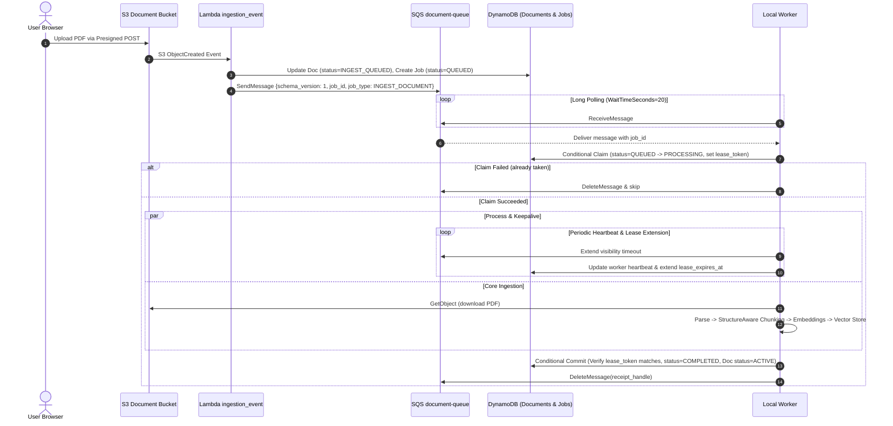

---

### 15.4. Operational Baseline Decisions
- **Host Environment:** Local workstation (utilizing local CPU/RAM/model cache, zero cloud compute overhead).
- **Execution Command:** `python -m src.worker.main` running as a dedicated foreground process from project root with `.venv`.
- **Telemetry & Logging:** Dual output:
  - **Console (stdout):** Colorized live feedback of queue polling and progress.
  - **File:** Rotating JSONL logs at `_data/logs/worker-YYYY-MM-DD.jsonl` for audit trails and post-mortem debugging.
- **Rollout Strategy:** **Option C (Phased Implementation)**:
  - *Phase 1:* Minimalist Worker handling `INGEST_DOCUMENT` end-to-end (read queue, claim job, run parser/chunker/embedder, commit status, delete message).
  - *Phase 2:* Add lease token renewal, heartbeat background thread, retry backoff, and interactive handlers (`ANSWER_QUERY`, `GENERATE_FLASHCARDS`, `DELETE_DOCUMENT`).

---

## 16. Local Worker Ingestion (Worker A) — Implementation Specifications

### 16.1. Pipeline Contracts & Interfaces

| Component | Class / Function | Input Contract | Output Contract | Notes |
|---|---|---|---|---|
| **PDF Parser** | `opendataloader_pdf.run()` | `input_path: str, keep_line_breaks=True` | JSON String | Official PyPI tool; requires Java 11+. |
| **Parser Adapter** | `adapt_opendataloader_json_to_parsed_blocks()` | `(dict, document_id: str)` | `list[dict]` (Parsed Blocks) | Maps bounding boxes, tables, headers, and semantic types. |
| **Chunker** | `StructureAwareChunker.chunk()` | `(blocks, document_id, "pdf", config)` | `ChunkBundle` (`.chunks: List[Chunk]`) | `config = {"max_tokens": 512}`. Respects header hierarchies. |
| **Chunk Serialization** | `dataclasses.asdict(chunk)` | `Chunk` dataclass instance | `dict` | Prepares chunk records for vector store insertion. |
| **Embedder** | `EmbeddingEngine.encode()` | `texts: List[str]` | `np.ndarray (N, 768)` (float32, L2) | Uses `paraphrase-multilingual-mpnet-base-v2`. |
| **Index Metadata** | `IndexMeta(...)` | 7 attributes from `EmbeddingEngine` | `IndexMeta` (Pydantic model) | `model_name, revision, dimension, max_seq_length, normalization, index_version, created_at`. |
| **Vector Store** | `SQLiteVectorStore.upsert_index()` | `(meta: IndexMeta, chunks: list[dict], vectors: np.ndarray)` | None | Persists vectors and metadata into SQLite table `embeddings`. |

---

### 16.2. Local Storage & Path Architecture

To ensure operational hygiene and prevent contamination between experimental benchmarks and production ingestion:

| Resource | Target Path | Rationale |
|---|---|---|
| **Vector Database** | `_data/studybot_index.db` | Dedicated SQLite database for real worker jobs (does not pollute `m3_index.db` evaluation artifact). |
| **Temporary Files** | `_data/tmp/` | Holds ephemeral downloaded S3 PDFs; cleaned up immediately post-ingestion. |
| **Worker Logs** | `_data/logs/worker-YYYY-MM-DD.jsonl` | Daily rotating structured audit log file. |

---

### 16.3. Worker Codebase Organization (`src/worker/`)

```text
src/worker/
├── __init__.py        # Package identifier
├── config.py          # Centralized configuration & environment loader (fail-fast validation)
├── logger.py          # Dual logging pipeline (console stdout + structured JSONL)
├── ingest.py          # INGEST_DOCUMENT processor (S3 download -> OpenDataLoader -> Chunker -> MPNet -> SQLite)
└── main.py            # Long-polling daemon loop (SQS poll -> DynamoDB claim -> Ingest -> Commit -> Delete)
```

---

### 16.4. Worker Configuration Contract (`config.py`)

#### Required Variables (Fail-Fast with `KeyError` if absent):
- `AWS_REGION`: Deployment region (`ap-southeast-2`).
- `QUEUE_DOCUMENT_URL`: SQS document queue URL.
- `QUEUE_INTERACTIVE_URL`: SQS interactive queue URL.
- `TABLE_JOBS`: DynamoDB jobs table name (`studybot-dev-jobs`).
- `TABLE_DOCUMENTS`: DynamoDB documents table name (`studybot-dev-documents`).
- `TABLE_WORKERS`: DynamoDB worker heartbeat table (`studybot-dev-workers`).
- `BUCKET_DOCUMENT`: S3 document storage bucket name.

#### Optional Variables (With sensible defaults):
- `WORKER_ID`: Defaults to `"worker-local-1"`.
- `SQLITE_PATH`: Defaults to `"_data/studybot_index.db"`.
- `TEMP_DIR`: Defaults to `"_data/tmp"`.
- `LOG_DIR`: Defaults to `"_data/logs"`.
- `EMBEDDING_MODEL`: Defaults to `"sentence-transformers/paraphrase-multilingual-mpnet-base-v2"`.
- `CHUNKER_STRATEGY`: Defaults to `"structure"`.
- `CHUNKER_MAX_TOKENS`: Defaults to `512`.
- `CHUNKER_CONFIG`: Dict `{"max_tokens": 512}`.


